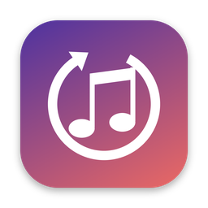
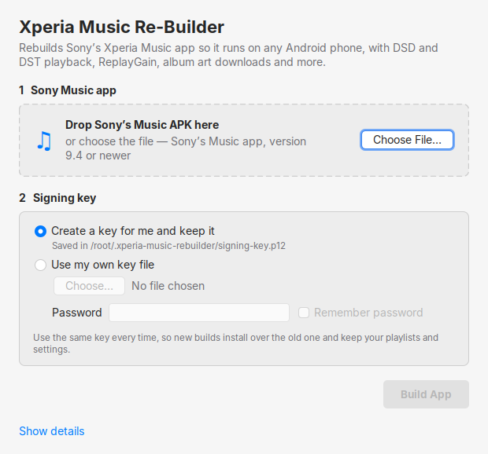
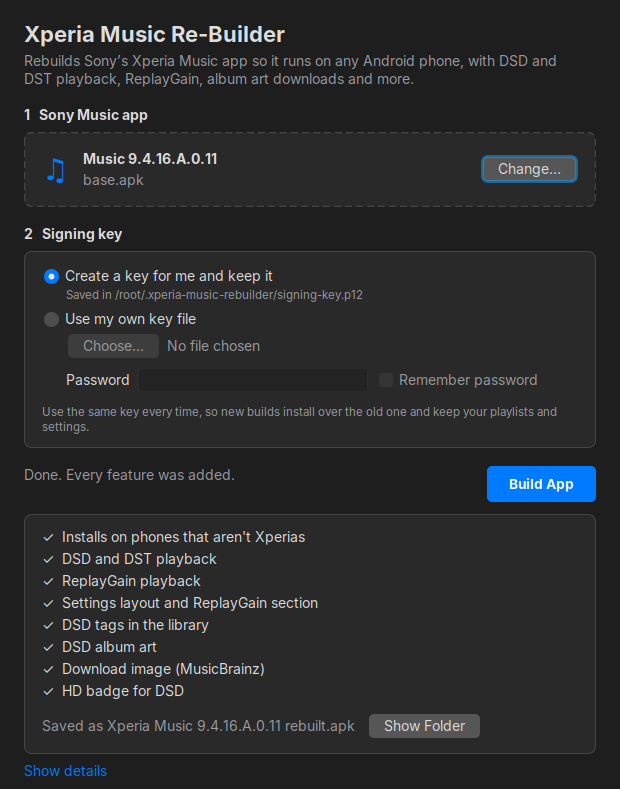

<p align="center"></p>

<h1 align="center">Xperia Music Re-Builder</h1>

<p align="center">Rebuilds Sony’s Xperia Music app so it installs on any Android phone, and adds DSD playback, ReplayGain, cover downloads and a tidier Settings screen.<br>For macOS and Windows.</p>

<p align="center">
  
  
</p>

## What it adds

- **Installs on any phone.** Sony’s app refuses to install on phones that aren’t Xperias. The rebuilt app doesn’t.
- **DSD and DST playback.** Plays DSF and DFF files, including DST-compressed SACD rips, by decoding them in software. A Settings switch turns this off for phones that handle DSD themselves.
- **DSD in the library.** Titles, artists, albums and cover art from DSD files show up properly, and DSD tracks get the gold HR (High-Resolution) badge.
- **ReplayGain.** Track or album gain, preamp, and a fallback level for untagged songs, in a new ReplayGain section of Settings. Clipping protection is always on.
- **ReplayGain scan.** “Add ReplayGain to files” measures every song without tags (EBU R128, using all CPU cores) and writes the tags into the files.
- **Download image.** Back in Edit album info: searches MusicBrainz by album and artist and offers covers at least 800 × 800.
- **Tidier Settings.** No empty icon space, titles lined up, unused service settings hidden.

## Download

Get the latest build from the [Releases](../../releases) page:

| Computer | File |
|---|---|
| Mac with Apple silicon (M1 and later) | `Xperia-Music-Re-Builder-mac-apple-silicon.zip` |
| Mac with an Intel processor | `Xperia-Music-Re-Builder-mac-intel.zip` |
| Windows 10 or 11 | `Xperia-Music-Re-Builder-windows.zip` |

No Java install is needed; everything is included.

**Mac:** unzip and drag the app to Applications. The app isn’t notarised by Apple, so the first time you open it macOS will say it can’t check it. Click Done, open **System Settings → Privacy & Security**, scroll down and click **Open Anyway**.

**Windows:** unzip the folder anywhere and run `Xperia Music Re-Builder.exe`. If SmartScreen appears, click **More info → Run anyway**.

## How to use it

1. **Get Sony’s Music app.** You need its APK (`com.sonyericsson.music`, version 9.4 or newer), for example copied off an Xperia. The Re-Builder doesn’t include it or download it. If you have a split app, use the `base.apk` inside it.
2. **Drop it on the window**, or click Choose File.
3. **Choose a signing key.** Android only installs an update over an app signed with the same key, so use the same one every time:
   - *Create a key for me and keep it.* The Re-Builder makes one and stores it in its settings folder.
   - *Use my own key file.* Choose a `.jks` or `.p12` file and enter its password. Use the key from an earlier rebuild to update that rebuild without losing your playlists and settings.
4. **Click Build App** and choose where to save. The window lists each feature with ✓, or ✗ and the reason if a future version of Sony’s app has changed too much for it.
5. Copy the APK to your phone and open it to install. If an older rebuild signed with a different key is installed, uninstall it first.

Where the key is kept:

- **Mac:** `~/Library/Application Support/Xperia Music Re-Builder/`
- **Windows:** `%APPDATA%\Xperia Music Re-Builder\`

Back up `signing-key.p12` and `signing-key.password` from there. Without them you can’t update the app later.

### Command line

```
"Xperia Music Re-Builder" --cli <sony-music.apk> <output.apk> <key.jks|key.p12> <password>
```

## How it works

The Re-Builder never rebuilds Sony’s resources. It:

1. unpacks only the app’s code with Apktool,
2. finds the right places in Sony’s code by what they do rather than by fixed line numbers, so newer versions of the app should keep working, and adds calls into the new code,
3. rebuilds only the code files it changed, and adds the new features as an extra code file (`payload.dex`, built from [`payload/src`](payload/src)),
4. marks Sony’s device library optional in the binary manifest,
5. puts everything back into a copy of the original APK, aligns it, and signs it with your key (APK signature schemes v1, v2 and v3).

## Building from source

Pushing to `main` builds the Mac and Windows apps with GitHub Actions ([`.github/workflows/build.yml`](.github/workflows/build.yml)). Pushing a tag such as `v1.0.0` also publishes them as a release.

To run from source on your own computer (JDK 17 or newer):

```
scripts/run-local.sh
```

To change the code that runs inside the Music app, edit `payload/src`, then run `scripts/build-payload.sh` (needs Android build-tools for `d8`).

## Credits and licences

The Re-Builder is MIT-licensed. The DST decoder in `payload/src/com/fpmod/dsd/DstDecoder.java` is a port of FFmpeg’s decoder and is LGPL-2.1-or-later. The release builds include Apktool, uber-apk-signer and FlatLaf (all Apache 2.0). See [NOTICE](NOTICE) for details.

Covers come from [MusicBrainz](https://musicbrainz.org) and the [Cover Art Archive](https://coverartarchive.org).

This project contains nothing of Sony’s and isn’t affiliated with or endorsed by Sony. Xperia is a trademark of Sony Group Corporation.
